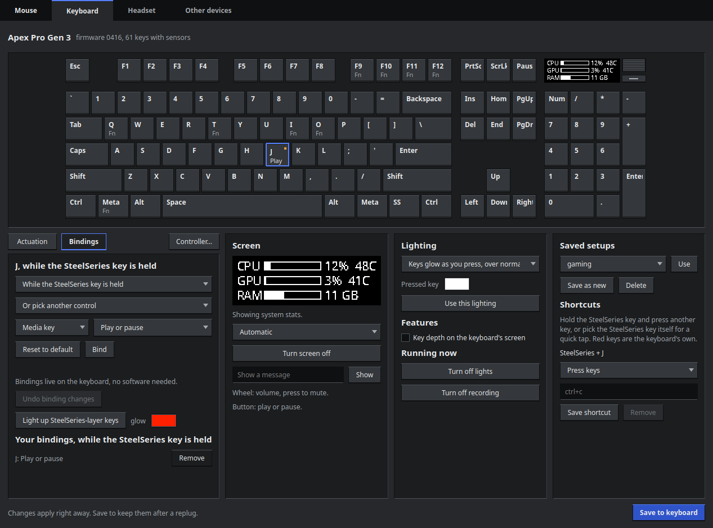
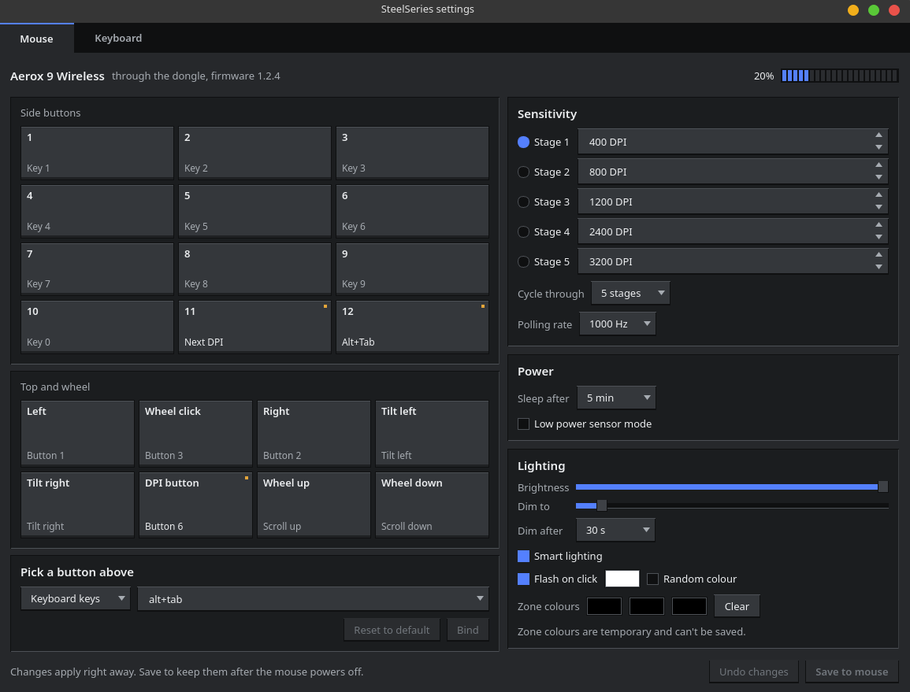
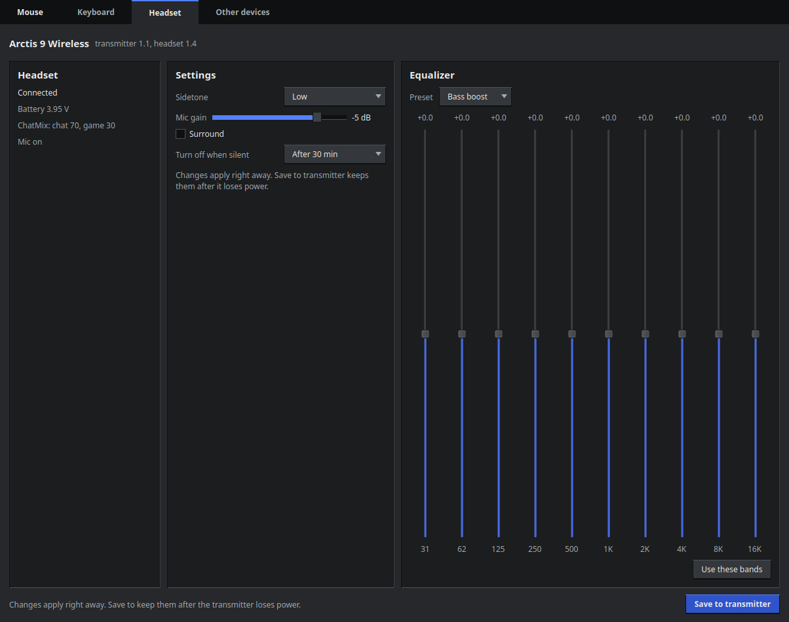
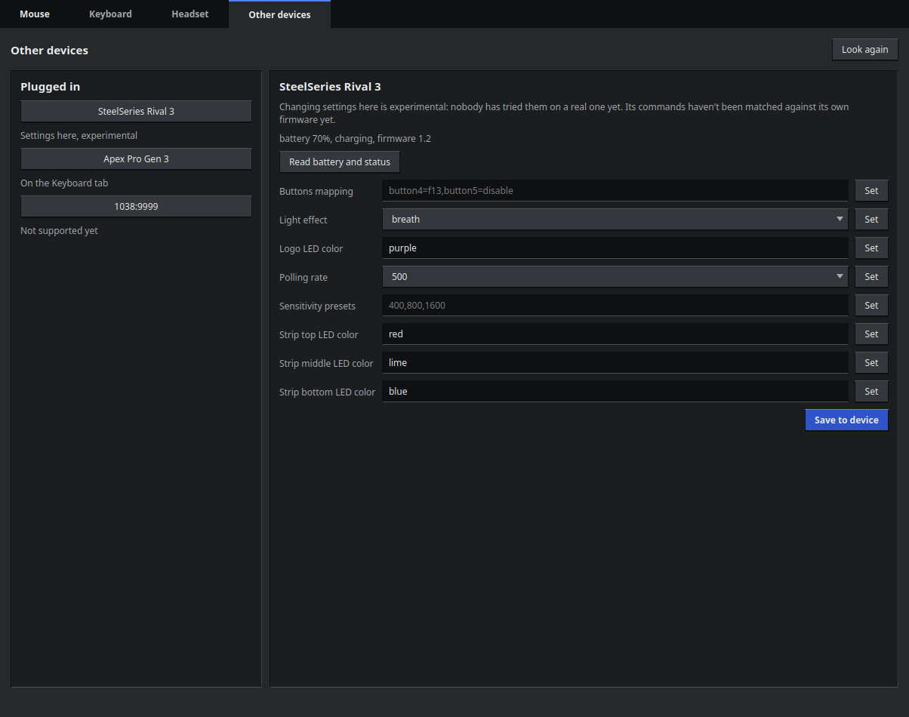
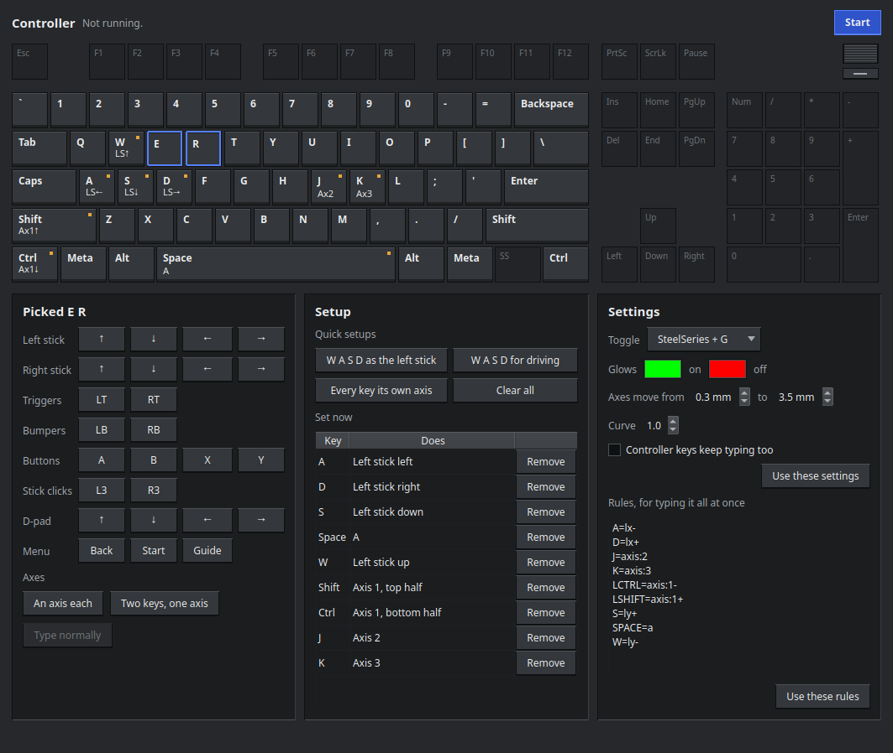
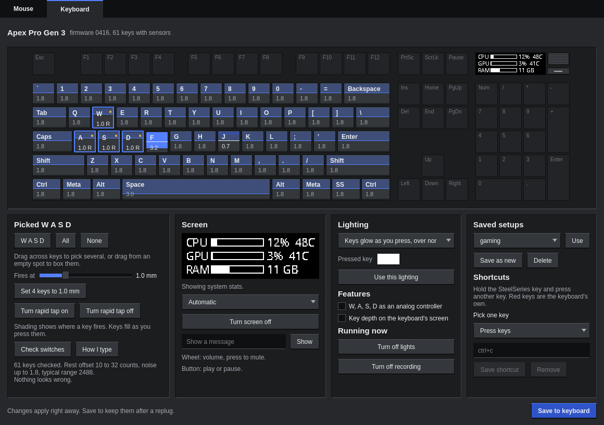
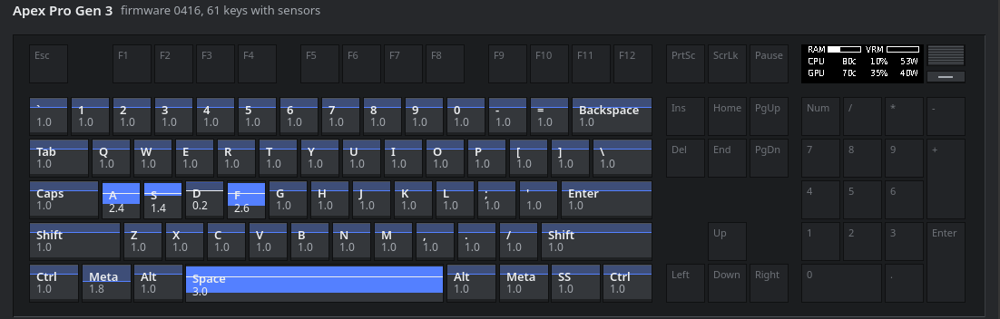
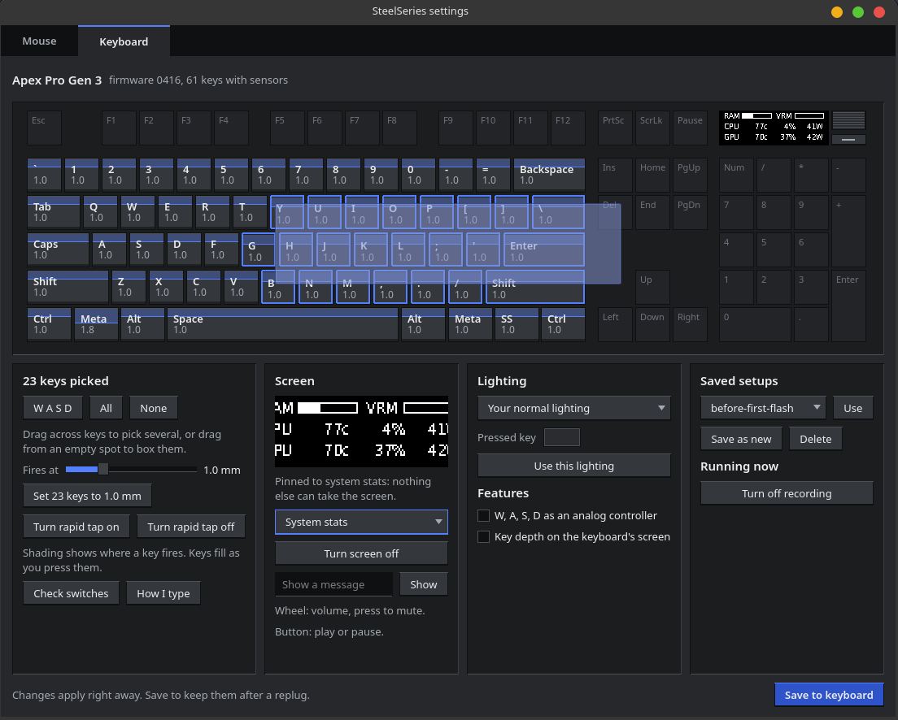
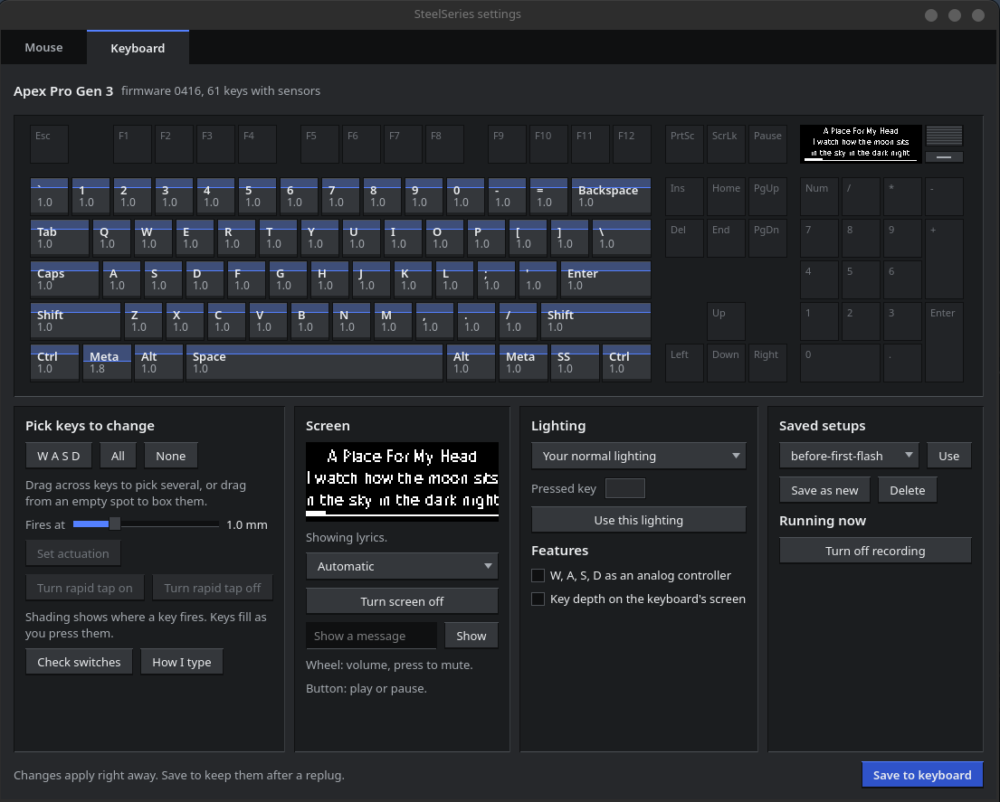
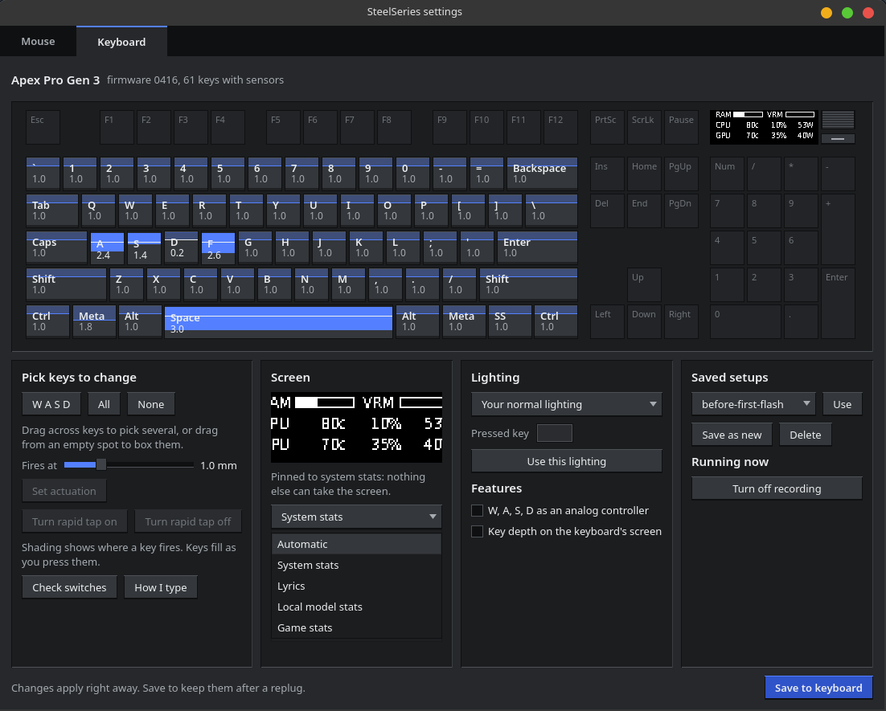

# steelmc

Configure SteelSeries gear on Linux with no vendor software. Not affiliated with SteelSeries.



| Folder | What it is | Device |
|---|---|---|
| [`devices`](devices/README.md) | `steelmc-devices`: which SteelSeries devices are plugged in, and settings for 80 more mice, 55 more headsets, 108 more keyboards (71 of them in MSI laptops), 28 MSI lighting devices, 11 mousepads, 2 microphones and 2 speakers: DPI, polling, lighting, buttons, actuation, rapid trigger, sidetone, EQ, battery, ChatMix | Any, and most Rival, Sensei, Prime, Kana, Kinzu and Aerox mice, Apex keyboards, Arctis headsets, QcK Prism pads and Alias mics |
| [`gui`](gui) | `steelmc`: one window for all of it | All of these |
| [`aerox`](aerox/README.md) | `aerox`: battery, DPI, polling, sleep, button bindings, lighting | Aerox 9 Wireless mouse |
| [`arctis`](arctis/README.md) | `arctis`: battery, ChatMix, sidetone, mic gain, EQ, surround and the sleep timer | Arctis 9 Wireless headset |
| [`apex-analog`](apex-analog/README.md) | `apex-analog`: live key depth, actuation, rapid tap, key bindings, lighting, shortcuts, and using key depth as analog input | Apex Pro Gen 3 keyboard |
| [`apex-oled`](apex-oled/README.md) | `apex-oled`: the keyboard's screen: system stats, lyrics, notifications, your own frames | Apex Pro Gen 3 keyboard |

## Install

**Any distro, for you:**

```
git clone https://github.com/milescoviello/steelmc
cd steelmc
./install.sh
```

It installs anything missing with your distro's own packages (Python, PySide6 for the app, Pillow for the keyboard's screen) on Arch, Debian, Ubuntu, Fedora, openSUSE, Gentoo and Alpine. Where the distro has no PySide6 (Ubuntu 24.04, say), it offers to get it from PyPI just for the app. It asks for your password once for the udev rules, so your devices open without sudo, and it puts SteelMC in your app menu. The commands point into the clone, so `git pull` updates them. `./install.sh --yes` doesn't ask anything. To install just some tools, run the `install.sh` in their folders.

**Any distro, system-wide:** `sudo make install` puts everything under `/usr/local`, and `sudo make uninstall` takes it out again. Packagers: `make DESTDIR="$pkgdir" PREFIX=/usr install`. `packaging/aur` has the Arch packages.

The command-line tools need only Python 3.8 or newer. The app needs PySide6, and `apex-oled` needs Pillow.

**Updating:** `steelmc-update` updates steelmc the way you installed it. In a clone, it pulls and runs `install.sh` again. With a package, it gets the newest release's package for your distro, checks it against the release's SHA256SUMS and installs it with your package manager. After `make install`, it gets the release's source and runs `make install` again. `steelmc-update --check` only says whether there's something new. When steelmc came from a package or `make install`, the app also shows a slim line at the top when a new release is out: Update runs `steelmc-update`, and Not now hides it until the next release. The app asks GitHub once a day at most, and `STEELMC_NO_UPDATE_CHECK=1` turns that off.

## The app

Run `steelmc`, or find SteelMC in your application menu.

**Mouse:** rebind any button, set DPI stages, polling rate and sleep time, and change lighting. Changes apply as you make them and last until the mouse powers off. **Save to mouse** keeps them, and **Undo changes** goes back to how things were when the page loaded.



**Headset:** shows whether the headset is connected, its battery, ChatMix and mic. Set sidetone, mic gain, surround, when it turns itself off, and the EQ, as a preset or ten bands. Save to transmitter keeps them.



**Other devices:** lists every SteelSeries device plugged in. For the ones the definitions in `devices/` cover, it reads battery, connection and ChatMix and shows a control for every setting, and says whether its commands were checked against its own firmware. Changes there are experimental.



**Keyboard:**
- Each key shows where it fires, fills as you press it, and sinks once it passes that point.
- Drag across keys to pick several, or drag from an empty spot to box them, then set their actuation or rapid tap.
- The keyboard's screen is mirrored live. You can choose what it shows, turn it off, or send it a message.
- **Bindings** rebinds any key on the keyboard itself, numpad and wheel included, so it works with no software running. Each key has three layers: normally, while the SteelSeries key is held, and on a deeper press.
- Keys bound on the SteelSeries layer glow while it's held, like the keyboard's own; pick the glow colour. **Your bindings** lists every change with a Remove button.
- Shortcuts fire when you hold the SteelSeries key and press another key. The keys the keyboard keeps for itself light up red while you hold it, and can't be used.
- **Controller…** opens a window that turns keys into a game controller: any stick direction, trigger or button, an axis of their own (up to 64), or two keys sharing one axis. Holding the SteelSeries key and a toggle key you pick turns it off and on, and that key glows to show which.













The last three are from a slightly older build, where the enlarged screen view was cut off at the sides.

## Safety

These tools come from reading each device's firmware, because commands aren't what they look like: on the mouse, some with the "read" bit set restore defaults and save to flash. Each tool only sends commands whose handlers have been read, and stops on firmware it hasn't seen. Writing to flash always takes an explicit save.

## Tests

```
python3 aerox/test_aerox.py
python3 arctis/test_arctis.py
python3 devices/test_devices.py
python3 devices/test_gear.py
python3 gui/test_gui.py                # nothing on screen
python3 apex-oled/apex-oled-test
cd apex-analog && python3 -m unittest  # creates virtual input devices if it's allowed to
```
