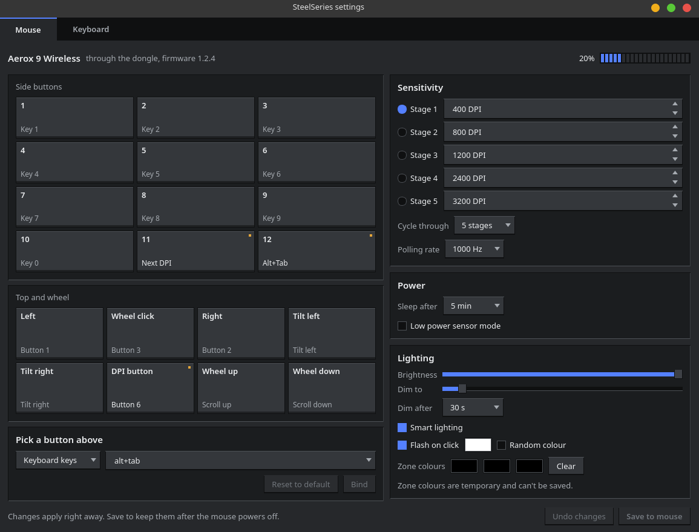
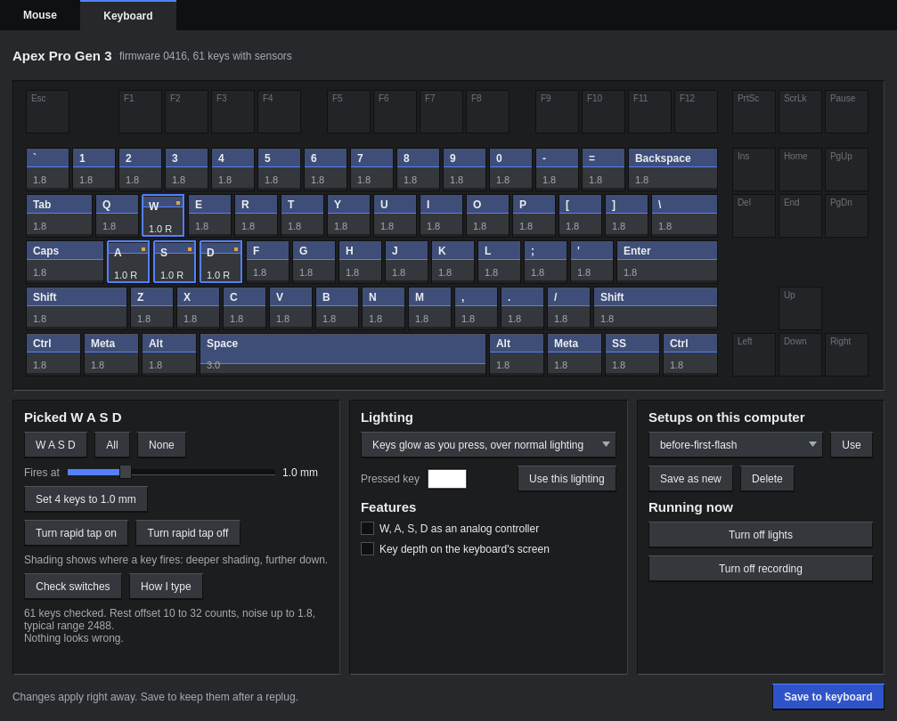
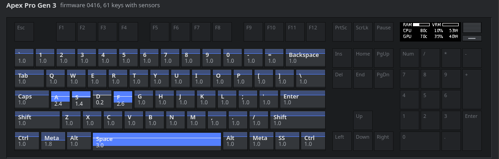
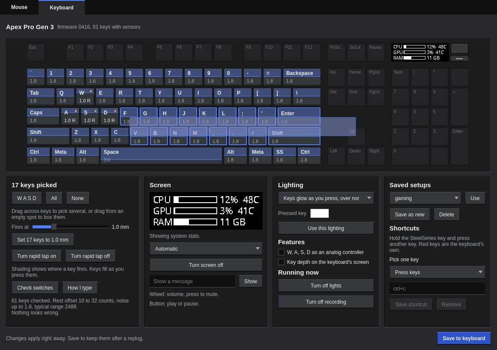

# aerox

Configure a SteelSeries Aerox 9 Wireless on Linux with no vendor software, from a command line or a GUI. The GUI also configures an Apex Pro Gen 3 keyboard, through [apex-analog](https://github.com/milescoviello/apex-analog).





## Install

```
./install.sh
```

This links `aerox` and `aerox-gui` into `~/.local/bin`, adds an application menu entry, and installs a udev rule. The rule opens only the mouse's vendor interface. The interfaces that carry clicks and keystrokes stay closed.

The command line needs only Python. The GUI also needs PySide6, and its keyboard page needs `apex-analog` on your PATH and `apex-oledd` running.

## GUI

Run `aerox-gui`, or find "SteelSeries settings" in your application menu. The full keyboard page screenshots use sample data.

Changes apply as you make them, but last only until the mouse powers off. **Save to mouse** writes them to its flash, and **Undo changes** goes back to how things were when the page loaded. The keyboard page works the same way, with **Save to keyboard**.

While the keyboard page is showing, each key fills as you press it and shows its depth in millimetres. It sinks once it passes the point where it fires.



Drag across keys to pick several at once, or drag from an empty spot to box them.



The keyboard page also mirrors what's on the keyboard's screen, and can pin what it shows, turn it off, or send it a message, through [apex-oled](https://github.com/milescoviello/apex-oled). The screen needs an `apex-oled` with the `frame` command.

## Command line

| Command | Does |
|---|---|
| `aerox` | Status |
| `aerox battery` | Battery level |
| `aerox dpi 400,800,1600 --stage 2` | Set DPI stages, or show them with no arguments |
| `aerox polling 1000` | 125, 250, 500 or 1000 Hz |
| `aerox sleep 5` | Minutes until it sleeps: 0 (off) to 20, in half minutes |
| `aerox low-power on` | The sensor's low power mode |
| `aerox buttons` | What each button does |
| `aerox bind "side 12" alt+tab` | Bind a button |
| `aerox light --brightness 8 --idle-minutes 1` | Brightness, idle dimming, smart lighting |
| `aerox color all ff5a00` | Temporary zone colours. `aerox color clear` undoes them |
| `aerox reactive on --color ffffff` | Flash on click |
| `aerox save` | Write changes to the mouse's flash |
| `aerox backup FILE`, `aerox restore FILE` | Copy settings to and from a file |
| `aerox info` | Device and firmware details |

Add `--json` to any of them for scripts.

**Buttons:** `left`, `right`, `middle`, `tilt left`, `tilt right`, `dpi`, `side 1` to `side 12`, `wheel up`, `wheel down`.

**Actions:** keys like `alt+tab` or `ctrl+shift+t` (up to 4 at once), `mouse1` to `mouse8`, `dpi`, `scroll-up`, `scroll-down`, `tilt-left`, `tilt-right`, `media:mute` (also `play-pause`, `next`, `previous`, `stop`, `volume-up`, `volume-down`), `none`.

## Safety

The protocol comes from reading the firmware's command handlers, because the commands aren't what they look like. Some with the "read" bit set restore defaults and save to flash. So:

- It can only send the exact commands in `ALLOWED`, and every argument is checked first. Anything else is refused before reaching the device.
- It stops on any firmware but 1.2.4, on both the dongle and the mouse.
- Every setting is read back after it's written.
- Only `aerox save` and the Save button write to flash. Both ask first, and neither runs on a nearly flat battery.

Changing the polling rate makes the dongle re-sync its radio, so the mouse drops out for about a second.

## What it can't do yet

- **Lighting effects.** Zone colours here are temporary. The stored effects use a format that's only partly decoded, and a bad one makes the mouse reset its lighting.
- **Actions that GG runs on Windows.** GG can attach software actions to a button, like its "switch apps" action or repeating clicks. These aren't on the mouse, so they do nothing on Linux. Alt+Tab works as a normal key binding instead, and on any computer.
- **Angle snapping and GG's acceleration settings.** What they map to on the mouse isn't known yet.
- **Macros.**
- **The keyboard's volume wheel and media button.** They're shown, but they keep what the keyboard does with them: volume, mute, and play or pause.

## Tested

On real hardware, through the dongle: every setting round-tripped in RAM, the GUI driven against both devices, one save to flash, which the mouse accepted, and Alt+Tab pressed on a side button. Not tested yet: a saved setting surviving a power cycle, the mouse plugged in by cable, and a RAM change surviving the mouse sleeping.

```
python3 test_aerox.py                   # no hardware
python3 test_gui.py                     # no hardware, nothing on screen
AEROX_HARDWARE=1 python3 test_hardware.py   # the real mouse, never saves
python3 screenshots.py OUTDIR           # render the GUI to PNG, nothing on screen
```
